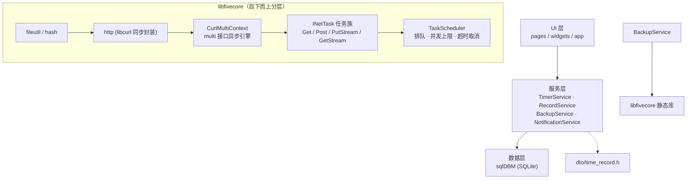

# FiveClock

基于 Qt6 的桌面时间记录应用：专注计时、记录沉淀、图表统计，并支持将本地记录备份/恢复到自建的 S3 兼容对象存储（MinIO）。

## 功能特性

- **专注计时** — 自研计时模型（`TimerModel`）与计时服务（`TimerService`），计时状态全程驻留内存，不触碰数据库
- **记录管理** — `RecordService` + SQLite 单一数据源，日历视图按天浏览记录
- **图表统计** — 基于 Qt Charts 的数据可视化页面
- **云端备份** — `BackupService` 通过预签名 URL 直传/下载对象存储，本地 SHA256 与云端校验值双向比对，配合 `TaskScheduler` 进行并发调度与超时取消
- **桌面宠物** — 独立置顶的宠物窗口
- **系统通知** — 计时结束等事件的通知提醒
- **启动画面** — 应用冷启动过渡页

## 界面预览

<table>
  <tr>
    <td width="50%" align="center" valign="top">
      <br>
      <b>主页 · 专注计时</b><br>
      <sub>大号数字时钟叠加当前计时读数，底部为开始 / 暂停 / 结束控制，左侧为功能导航</sub>
    </td>
    <td width="50%" align="center" valign="top">
      <br>
      <b>记录 · 日历视图</b><br>
      <sub>按月排列的日历格子，按天浏览记录；无数据时提示「记录为空」，右下角为新增按钮</sub>
    </td>
  </tr>
  <tr>
    <td align="center" valign="top">
      <br>
      <b>统计 · 空状态</b><br>
      <sub>顶部为当前日期与日期范围选择，连续记录未满七天时以插画式空状态提示</sub>
    </td>
    <td align="center" valign="top">
      <br>
      <b>桌面宠物</b><br>
      <sub>独立置顶的透明宠物窗口，悬于桌面之上、不抢占焦点</sub>
    </td>
  </tr>
  <tr>
    <td align="center" valign="top">
      <br>
      <b>宠物快捷菜单</b><br>
      <sub>右键唤出：开始计时 / 暂停·继续计时 / 分项次数+1 / 结束计时 / 隐藏 / 退出</sub>
    </td>
    <td width="50%" valign="top"></td>
  </tr>
</table>

> 截图分辨率 1024×576，来源为开发机实际运行画面。

## 项目结构

```
FiveClock/
├── include/                # 头文件（目录结构与模块一一对应）
│   ├── app/                # 应用骨架：主窗口、启动页、宠物窗口
│   ├── pages/              # 页面：主页、图表页、子页面、对话框
│   ├── widgets/            # 通用控件：日历、按钮
│   ├── service/            # 业务服务层
│   ├── config/             # 配置服务
│   ├── db/                 # 数据访问接口与 SQLite 实现
│   ├── dto/                # 跨层数据传输对象
│   └── timer/              # 计时模型（纯内存状态）
├── src/                    # 源文件（与 include 同构）
│   └── ui/                 # .ui 表单文件
├── libfivecore/            # 独立静态库：libcurl 网络层
│   ├── include/fivecore/
│   ├── src/
│   └── tests/              # GTest 单元测试
├── test/                   # 应用层单元测试（GTest + GMock）
├── pic/                    # 界面截图（README 预览用）
└── config.json             # 备份服务器网络配置（运行时复制到可执行目录）
```

## 架构

依赖方向自上而下，上层感知下层、下层不感知上层；服务之间互不依赖，只有应用骨架同时持有多个服务。



- **计时与存储分离**：`TimerService` 只管计时业务，`RecordService` 只管记录读写，二者互不感知
- **备份三段式**：同步前奏（校验/哈希/预签名申请）→ 异步传输（libcurl IO 线程）→ 同步收尾（confirm / 完整性校验），回调经 `Qt::QueuedConnection` 跳回服务线程
- **libfivecore 分层复用**：`TaskScheduler` 仅依赖 `INetTask` 抽象基类，不知道任何具体任务类型

## 构建指南（Windows）

### 依赖

| 依赖 | 版本要求 | 说明 |
|---|---|---|
| Qt6 | 6.x | 组件：Core / Gui / Widgets / Sql / Charts / Multimedia / MultimediaWidgets |
| CMake | ≥ 3.16 | 主工程；libfivecore 子目录要求 ≥ 3.20 |
| 编译器 | MSVC 或 MinGW | C++17（libfivecore 为 C++20） |
| libcurl | 8.x | libfivecore 依赖 |
| OpenSSL | 3.x | SHA256 摘要与 TLS |
| nlohmann_json | — | JSON 解析 |
| spdlog | — | 日志 |
| GTest / GMock | 1.14 | 仅单元测试需要 |

### 步骤

```bash
# 1. 配置（Qt 路径按本机安装位置调整）
cmake -B build -DCMAKE_BUILD_TYPE=Release -DCMAKE_PREFIX_PATH="<Qt安装目录>/lib/cmake"

# 2. 构建（同时构建主程序 FiveClock 与单元测试 FiveClockTests）
cmake --build build --config Release

# 3. 运行测试
cd build && ctest --output-on-failure
```

> 说明：`libfivecore/CMakeLists.txt` 中 libcurl / OpenSSL / GTest 的查找路径当前指向本机目录（`G:/cppsoft/...`、`C:/msys64/...`），在其他机器构建前需按实际安装位置调整，或改用 vcpkg 等包管理器统一提供。

## 运行时配置

程序启动时读取可执行文件同目录下的 `config.json`（构建后自动复制），缺失或字段为空时回退内置默认值：

```json
{
  "backup": {
    "base_url": "http://127.0.0.1:8000",
    "presign_upload_path": "/api/presign/upload",
    "presign_download_path": "/api/presign/download",
    "upload_confirm_path": "/api/upload/confirm"
  }
}
```

备份功能需要配套的签名服务端（FastAPI + MinIO，见架构中的 `base_url`）。

## 设计约束

工程在演进中沉淀了一批硬性约定，详见源码与提交历史：

- 所有 `Q_OBJECT` 类独立头文件，UI 控件统一在 `.cpp` 中以父指针初始化
- UI 只通过 setter 接收服务指针，不自行创建服务；服务实例化顺序 `SqlDBM → RecordService → TimerService`
- 服务层不依赖彼此、不持有 Widget；跨服务协作只发生在应用骨架层
- libcurl 全局初始化守卫 `CurlGlobalGuard` 必须是首个/最后一个销毁的 curl 对象；所有异步回调不在 libcurl IO 线程做阻塞操作
